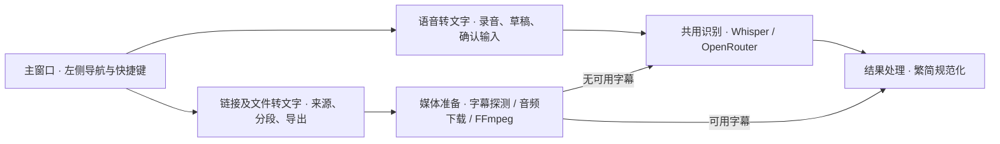

# VoiceInput V0.2 结构设计

评审稿 · 2026-11-19
依据为用户提供的《Voice Input V0.2｜产品需求文档》1.0 版。代码基线为当前工作区的 `db8b4b2`。

## 1. 现状与设计选择

| 现有实现 | 设计影响 |
|---|---|
| `MainWindow.xaml.cs` 管理录音、视频、结果编辑、输入目标和配置。两类任务共用结果区，部分命令通过 `busy`、`videoBusy` 互相阻塞。 | 固定左侧导航，两个页面分别持有草稿、任务状态和取消令牌；主窗口负责导航、快捷键和退出。 |
| `AudioCapture` 生成 16 kHz 单声道 WAV，语音页已保留录音供重识别。`DesktopInput` 已负责目标焦点校验和文字输入。 | 复用录音与 Windows 输入实现；只有语音页可以确认输入。 |
| `WhisperEngine` 调用本地 whisper.cpp CLI，已有语言参数和 GPU 开关，当前请求 TXT。README 记载现有发行版默认 tiny CPU，工作区另有 small 文件。 | 先验证中文语言参数与模型差异，在需要字幕时读取引擎时间段。保留有效模型路径与设备设置。 |
| 当前 `CloudRecognition` 向 OpenRouter 上传 WAV 并读取纯文本。 | 云端语音识别走显式选择和提示，继续用 DPAPI 保存密钥。按现有接口能力返回纯文本。本地媒体转写用能提供时间段的 Whisper。 |
| `VideoTranscriber` 调用 yt-dlp 和 FFmpeg，当前音频选择会回退到含视频的格式；下载、转换、本地识别后返回文本，失败也会清理任务目录。已有下载阶段进度和取消。 | 增加字幕检查和纯音频选择。失败后保留完好的音频供识别重试。将进度、结果和错误从工具输出提取为结构化数据。 |

建议在现有 .NET 8／WPF 项目内拆分两个 `UserControl` 和各自的页面状态，共用识别与文本规范化服务。仅拆 XAML 改动较小，但会留下共享草稿和命令耦合。拆成多个工程则会增加迁移、依赖管理及发布成本。单工程内按职责拆分能直接满足本轮验收，保留现有组件、色彩、术语与三语界面资源。

## 2. 导航、任务和草稿

- 主窗口创建并持有两份页面状态。右侧只显示当前页面，默认进入「语音转文字」。切页只切换可见内容。两个页面分别保留来源输入、识别设置、可编辑草稿、错误提示和任务耗时。
- 「语音转文字」沿用开始／结束录音、选择本地或云端、重新识别、编辑、复制和确认输入。全局热键仍控制录音。识别后预览，确认后才调用现有桌面输入逻辑；目标无效时保留结果供复制。
- 「链接及文件转文字」提供链接框、文件选择、开始／取消／重试、阶段和计时、结果及 TXT／SRT 导出。有时间轴时按字幕段编辑正文，TXT 和 SRT 都读取同一份编辑稿；纯文本结果可作 TXT 使用。
- 每页最多一项活动任务，分别拥有任务 ID、参数快照和取消令牌。两页任务可同时存在；建议第一版共享一个本地推理名额，语音在等待队列中优先，已经运行的识别自然完成。排队仅占用自己的任务状态，录音、下载和字幕读取仍可进行，取消只影响所属任务。推理并发或分段抢占需在实测后决定。
- 原始结果与可编辑草稿分别保留。任务完成时用任务 ID 和草稿修订号检查回写。用户已编辑，或原稿已有未保存改动时，新结果作为候选，用户可预览后替换；失败、取消、切页或改设置均保留草稿。程序退出时先处理未保存编辑，再取消并清理两页任务。本轮状态保持限于运行期间，跨重启恢复留待后续评估。

## 3. 统一转写结果与中文输出

| 数据 | 设计 |
|---|---|
| 识别请求 | 音频文件、识别语言、识别来源、是否需要时间段及本次任务的设置快照。界面语言由现有本地化模块单独处理。 |
| 转写结果 | 原始正文、可选的有序时间段、来源（人工字幕／自动字幕／本地引擎／云端引擎）及可选语言。每个时间段含开始、结束和正文。 |
| 可编辑草稿 | 纯文本或带时间段正文，加修订号与未保存状态。识别产物在进入草稿前转换字形；已编辑的字形按用户原稿保存。 |

新配置默认识别语言为普通话 `zh`、输出为简体。已有明确的识别语言和有效模型路径在升级时保留；自动、中英文均可手动切换。Whisper 中文请求传 `-l zh`，始终使用转写任务。需要时间段时读取经过版本验证的 CLI 结构化输出，并保留原始时间。先用同一组录音对比 tiny、small 和旧版设置，按准确率和耗时决定推荐模型。 [whisper.cpp v1.8.3 CLI](https://github.com/ggml-org/whisper.cpp/blob/v1.8.3/examples/cli/cli.cpp)

繁简转换集中在离线文本处理模块，优先验证 OpenCC 的标准 `t2s`／`s2t` 配置。保留英文、数字、URL、代码以及显式标记的专名，转换普通中文片段。用样本验证中英混排、繁简歧义与专名；自动辨认所有未知中文专名没有可靠的验收依据，因此保留原始识别稿供核对。具体 .NET 接入方式、运行库和许可证随 Windows 发布验证确定。 [OpenCC 配置与词组规则](https://github.com/BYVoid/OpenCC#configurations-配置文件)

## 4. 媒体获取、阶段与导出

1. **获取信息和检查字幕。** 链接复用现有公开 URL 校验。使用机器可读的媒体元数据，匹配源语言或用户选定的语言。建议优先同语种人工字幕，其次同语种自动字幕。显示字幕来源，可直接采用，亦可手动重跑音频识别。首版解析 VTT／SRT。字幕缺失、不可读或不匹配时走音频路径；源链接受限或失效时显示具体原因。 [yt-dlp 字幕选项](https://github.com/yt-dlp/yt-dlp#subtitle-options)
2. **下载或导入音频。** 链接仅选用音频轨。平台没有可分离音频流时提示该来源不可按纯音频方式下载，仍可导入本地文件。文件导入建议首轮验证 WAV、MP3、M4A、FLAC、MP4、MKV、WebM，按实际音轨和解码结果判断，每次导入单个文件。兼容 WAV 直接交给识别引擎，其余提取或转换一次。原始本地文件只读。
3. **识别和生成结果。** 本地文件和下载音频使用同一识别路径。先复用完整音频、稳定解析时间段并记录峰值资源占用。长音频是否按段处理由约两小时样本的耗时、内存和字幕接缝质量决定；若采用分段，实现时需记录时间偏移、处理重叠去重，并在同一全局时间轴导出。
4. **进度与重试。** 阶段分别为获取信息、检查或读取字幕、下载音频、准备音频、排队、识别和生成结果，另有完成、失败、已取消终态。显示任务总耗时和当前阶段耗时；文件大小、可验证的阶段进度或已处理总时长可作为分母，其他阶段显示不定进度。失败提示包含阶段、可读原因和对应的重试入口。音频完整但识别失败时，从识别阶段重试；仅保留每页仍可重用的最近产物，临时数据在替换、明确清理或正常退出时释放。取消终止该任务拥有的子进程。
5. **导出。** TXT 使用 UTF-8，保留草稿换行。SRT 使用 UTF-8，从 1 连续编号，时间格式为 `HH:mm:ss,fff --> HH:mm:ss,fff`。导出前校验非负时间、开始早于结束、按时间排序及有效正文；对平台原有重叠字幕保留其时序并纳入导入兼容性测试。没有时间段时禁用 SRT 并说明原因。覆盖目标文件沿用 Windows 保存确认。

本地识别的音频与正文留在本机。公开视频路径访问对应平台；显式使用 OpenRouter 时按现有转写路径提示上传录音。默认日志记录阶段、耗时、模型、后端及错误类别，不保存音频内容、转写正文、密钥、完整带参数链接或未过滤的外部工具输出。

## 5. 受影响文件与实施顺序

| 阶段 | 文件与职责 | 通过条件 |
|---|---|---|
| P0 · 页面拆分 | `MainWindow.xaml(.cs)` 保留外壳与快捷键；新增语音页、媒体页和各自状态；`MainWindow.Localization.cs`、`InterfaceLanguage.cs` 延用现有本地化组织。 | 两页草稿隔离，切页不终止任务；录音、重识别、复制、确认输入和三语界面回归。 |
| P0 · 中文处理 | `WhisperEngine.cs`、`CloudRecognition.cs` 经统一识别入口调用；新增转写结果、中文规范化及设置迁移。 | 同源中文样本对比旧版 CER、延迟与典型错误，无意外翻译；保留英文、数字及测试专名。 |
| P0 · 进度与生命周期 | `VideoTranscriber.cs` 接入阶段事件、每页取消、可重试产物和最小日志；录音和识别路径也发阶段事件。 | 跨页后台继续，取消只影响所属页面；过期任务结果不能覆盖草稿，失败可按阶段重试。 |
| P1 · 字幕、文件及导出 | 扩展 `VideoSource.cs` 和媒体流程；新增字幕解析和 TXT/SRT 导出；更新 README、视频说明与现有测试工程。 | 原字幕路径跳过音频下载和识别；无字幕、错误链接、不可解码文件均有实测。SRT 往返解析并用常用剪辑软件实际导入。 |

复用 NAudio、whisper.cpp、yt-dlp 和 FFmpeg；候选新增依赖为 OpenCC 繁简数据与相应运行库。P2 的用户词典自动学习、复杂语义纠错和智能静音过滤列入后续，实时视频字幕在本版范围之外。

## 6. 验收与待测项

- **中文准确率。** 固定一批普通话短句、长句、中英夹杂、数字和专名，制作参考稿。同一 WAV 对比旧版、默认 `zh` 和候选模型。分别记录原始 CER、统一字形后的 CER、错误类型和端到端耗时，避免把繁简转换计成声学识别改善。
- **媒体性能。** 约 10 分钟和约 2 小时的媒体各记录可获取字幕和无字幕两类路径；分别记录各阶段耗时、总耗时、下载体积、峰值内存及失败重试时是否重复下载。用本地 WAV／MP4 将推理耗时与网络耗时分开；报告实测值。
- **状态与可靠性。** 覆盖较长任务中切页、编辑后晚到结果、两个页面分别取消、网络断开、链接受限、字幕损坏、磁盘不足和长文件导出。检查工具进程退出、缓存清理、未保存稿保留和日志脱敏。
- **本机与发布。** 本机 CPU 已核对为 Snapdragon X；GPU 型号、可用加速后端及当前工具的实机运行仍需验证。本工作区 `tools` 目录当前只有第三方说明，未见 yt-dlp／FFmpeg 可执行文件。验收需记录 Windows、应用及工具架构、引擎版本、模型和加速后端；保留现有 Windows x64 发行兼容性，另验证本机 ARM64 环境所用的实际运行方式。
